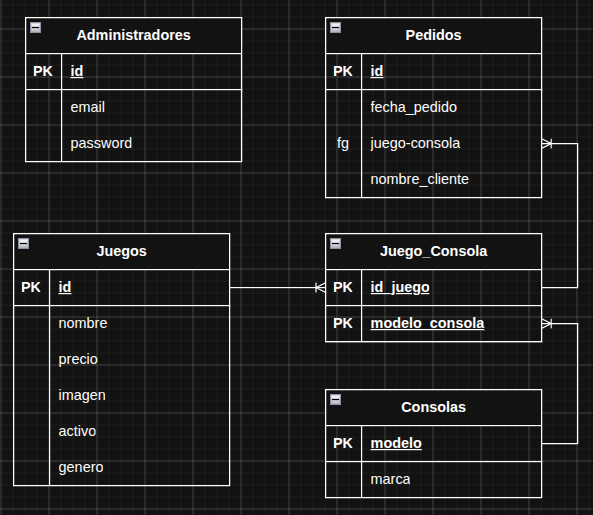

Ver la [consigna del trabajo practico](docs/consigna.md).

### Tablero de Scrum: [Trello del TP](https://trello.com/invite/b/6ae512eb99858263760ee4b9/ATTIb0e9d89060df1898439e85ce9bb6ce9d79F0B2D1/tp-integrador-prog-iii)

### La regla de oro:

Una tarjeta = una rama = un PR (pull request). Escribir el nombre de la rama en la tarjeta (feature/crear-producto), y al abrir el PR pegar el link de la tarjeta en la descripción. Así se sabe qué código corresponde a cada tarea.

### Ciclo para utilizar ramas

```
git checkout main
git pull                           # traer lo último
git checkout -b feature/readme     # crear tu rama (el nombre lo elegís vos)

# ... hacés los cambios (README, imagen, etc.) ...

git add .                          # o archivos puntuales: git add README.md docs/img/
git commit -m "Agrega consigna e imagen al README"
git push -u origin feature/readme  # subir la rama
```

Después, en GitHub aparece el botón Compare & pull request. Abrís el PR y hay que revisar antes de mergear.

Si ya estás en una rama y es otro cambio más
No hace falta crear otra. Solo:

```
git add .
git commit -m "Mensaje"
git push
```

(el -u se usa solo la primera vez).

### Dos comandos para ubicarte

git status: te dice en qué rama estás y qué archivos cambiaron.
git branch: lista las ramas locales.

## Modelado de clases

