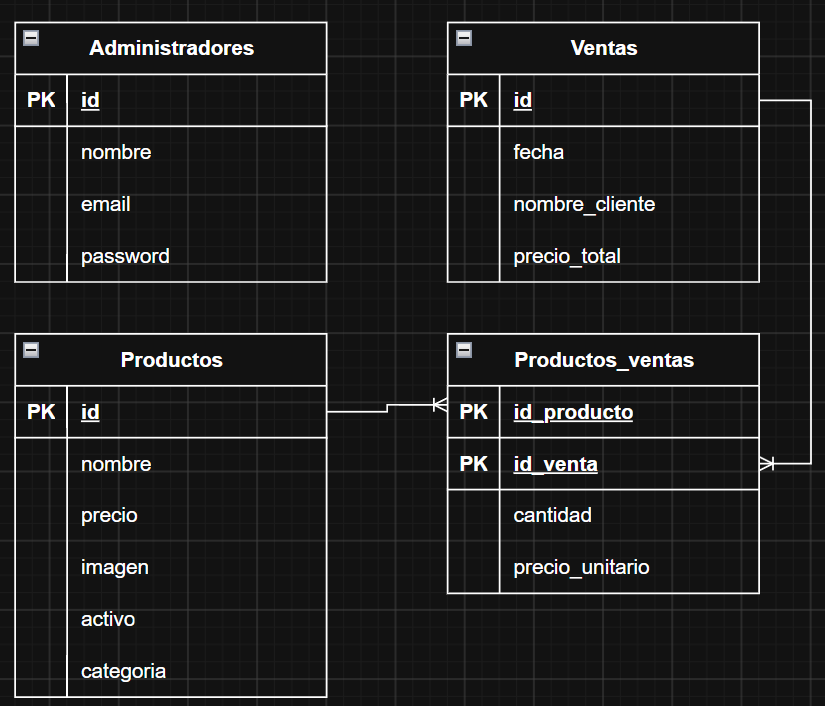

### Ver la [consigna del trabajo practico](docs/consigna.md).

### Tablero de Scrum: [Trello del TP](https://trello.com/invite/b/6ae512eb99858263760ee4b9/ATTIb0e9d89060df1898439e85ce9bb6ce9d79F0B2D1/tp-integrador-prog-iii)

### Ciclo para utilizar ramas

```
git checkout main
git pull                           # traer lo último
git checkout -b feature/readme     # crear tu rama (el nombre lo elegís vos)

# ... hacés los cambios (README, imagen, etc.) ...

git add .                          # o archivos puntuales: git add README.md docs/img/
git commit -m "Agrega consigna e imagen al README"
git push -u origin feature/readme  # subir la rama
```

### Modelado de clases



### BD con datos

[descargar archivo](docs/tp_integrador.sql)
